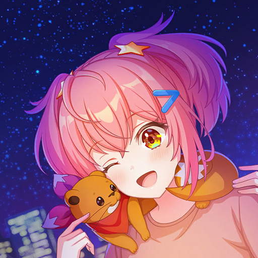

<div align="center">



# SiriusStoryMaker

**Desktop ADV Story Authoring & Playback Studio for *World Dai Star***

**English** | [简体中文](README.zh-CN.md)

[](LICENSE)
[](https://www.electronjs.org/)
[](https://vuejs.org/)
[](https://pixijs.com/)
[](https://www.typescriptlang.org/)

Visual Storyboard Graph · Live Spine 4.1 Stage Preview · Standalone Story Player · Native 1080p MP4 Export · Local AI Director (CLI / API / MCP)

</div>

---

## Features

- **4-Zone NLE Visual Workbench**: Asset Bin & Outline on the left, 16:9 Live Stage Preview on top, Frame & Scene Inspector on the right, and a full-width Storyboard Graph at the bottom. Seamlessly switch between **Visual Graph** and **DSL Source** with a unified undo/redo stack.
- **Live Spine 4.1 Stage Rendering**: Embedded customized WDS Adv Player updates characters, expressions, body motions, backgrounds, effects, and dialogue in real time. Supports indexed cue seeking for long scripts, frame-by-frame scrubbing, and scene auditioning.
- **Project-Based Authoring & Asset Manager**: Manage `.sav` projects with local custom backgrounds, BGM, SE, and Vocal audio (PNG/JPEG/WebP & MP3/OGG/WAV). Inspect asset usage and remove unused files from the built-in **Project Files** bottom tab.
- **Persistent Disk Thumbnail Cache**: Background and CG thumbnails are cached to disk automatically; Spine character portraits are rendered offscreen and updated incrementally. The large Asset Picker dialog supports category filtering and infinite scrolling.
- **Portable ZIP Export & Standalone Player**: Preflight and export self-contained `.zip` story packages (`episode.json`, `story.dsl`, `manifest.json`, and local assets). The Project Launcher includes a standalone player that opens `.zip` packages or `.json` files directly with native opening covers and auto-play.
- **Native MP4 Video Export**: Record the stage canvas and 3-channel audio mix (BGM / SE / Vocal) using local FFmpeg to produce `1080p 30fps H.264/AAC` MP4 videos.
- **AI Director (Local Harness + API + Skills + MCP)**: Integrates with local Codex CLI, Claude Code, DeepSeek Harness (`dsh`), Antigravity CLI, Gemini CLI, OpenCode, and DeepSeek / OpenAI-compatible APIs, powered by built-in authoring Skills and a Studio MCP server.
- **Bilingual Interface**: Built-in **English** and **Simplified Chinese (简体中文)** UI with instant switching in the Launcher and Settings.

---

## Quick Start

### Prerequisites

- **Node.js** 20+ and **npm**
- Desktop environment capable of running Electron (Windows / macOS / Linux)
- *Optional*: **FFmpeg** with `libx264` and `AAC` encoders for MP4 video export (configurable via **Settings → Project & Assets**)

### Install & Run

```bash
# 1. Install root and embedded player dependencies
npm ci
npm ci --prefix player

# 2. Start development mode (builds player & MCP server, then launches Vite + Electron)
npm run dev
```

Available scripts:

| Command | Description |
| --- | --- |
| `npm run dev` | Build the preview player & MCP server, then launch Vite + Electron |
| `npm run build` | Full production build (player, MCP server, renderer, Electron main/preload) |
| `npm start` | Run a full build and launch the desktop app |
| `npm test` | Run unit tests for DSL compiler, project storage, ZIP export, video export, i18n, and AI harnesses |

---

## Project Layout & Workflow

On launch, SiriusStoryMaker opens the **Project Launcher**, where you can create a new `.sav` project, reopen recent projects, or click **Play Story Package** to watch an existing `.zip` / `.json` directly.

### Project Directory Structure

```text
my-story/
├── project.sav          # JSON project index (relative paths & imported local assets)
├── story.dsl            # Editable story DSL (scenes, branches, dialogue, stage cues)
├── assets/
│   ├── background/      # Custom backgrounds (PNG / JPEG / WebP)
│   ├── bgm/             # Background music (MP3 / OGG / WAV)
│   ├── se/              # Sound effects (MP3 / OGG / WAV)
│   └── voice/           # Vocal / voice lines (MP3 / OGG / WAV)
└── ai-cache/
    ├── history.json     # Project-scoped AI chat history
    └── workspace/       # Working copy passed to local AI Harnesses
```

> **Tip**: Copy the entire project folder when backing up or moving a project; `project.sav` alone does not contain the script or assets. Existing `.story`, DSL, or ADV JSON files can be imported via **File → Import**.

### Shortcuts & Editing Tips

- **Shortcuts**: `Ctrl/Cmd+S` Save · `Ctrl/Cmd+Z` Undo · `Ctrl/Cmd+Y` / `Ctrl/Cmd+Shift+Z` Redo · `Ctrl/Cmd+O` Project Launcher · `Ctrl/Cmd+,` Settings · `Esc` Close modal/menu.
- **Scene BGM & Frame Audio**: Assign BGM at the scene level (or drag music onto a scene card); leave empty to inherit the previous scene's BGM, or choose **Stop Music** (`bgm="stop"`). SE and Vocal audio are configured per frame.
- **3-Channel Audio Mix**: Adjust BGM / SE / Vocal volumes and preview mute centrally in **Settings → Audio**. Preview mute does not affect asset auditioning or MP4 video export volume.

### Exporting ZIP Packages & MP4 Videos

- **Export Story Package (`.zip`)**: Runs preflight checks on frame count, DSL diagnostics, and local asset references. `episode.json` contains the **currently selected route** in WDS ADV format, while full branching is preserved in `story.dsl`. AI caches and API keys are never packaged.
- **Export Story Video (`.mp4`)**: Choose **File → Export Story Video (MP4)** to record the native opening cover, stage playback, and 3-channel audio mix to `1080p 30fps H.264/AAC`. If FFmpeg is not installed, download a build from [BtbN/FFmpeg-Builds](https://github.com/BtbN/FFmpeg-Builds/releases) and select it in **Settings → Project & Assets**.

---

## AI Director (Harness / API / Skills / MCP)

Open the AI Director dock or configuration modal from the top **AI** menu:

| Provider | Usage |
| --- | --- |
| **Codex CLI** | Uses your local authenticated `codex` CLI, querying available models and reasoning efforts automatically |
| **Claude Code** | Reuses local `claude` auth & settings with model aliases, custom model IDs, and session resume |
| **DeepSeek Harness (`dsh`)** | Uses your configured `dsh` `headless` profile for auth and model management |
| **Antigravity / Gemini / OpenCode** | Auto-detects locally installed `agy` / `gemini` / `opencode` CLIs |
| **DeepSeek / OpenAI-Compatible API** | Built-in DeepSeek API mode (reads `DEEPSEEK_API_KEY`) or any OpenAI-compatible Base URL & key |

AI edits operate on a working copy under `ai-cache/workspace/` and sync into the editor's unified undo history upon success. API keys and provider preferences are stored locally in the app data directory and are never shared with projects.

### Optional: Local Official Story Corpus

Official episode data is not distributed with this repository. If you have local WDS episode JSON files, you can build an optional index for MCP reference queries:

```bash
SIRIUS_EPISODE_DIR=/path/to/episode node scripts/build-official-kb.mjs
```

The index is written to `data/official-story-kb.json` by default (override with `SIRIUS_KB_PATH`). All editing, preview, export, and AI features work without it.

---

## Repository Architecture

```text
SiriusStoryMaker/
├── electron/         # Electron main process: windows, project I/O, ZIP, FFmpeg MP4 export, thumb cache, AI CLI & MCP
├── src/              # Vue 3 + TypeScript renderer: NLE workbench, StoryGraph, Inspector, Asset Picker, AI panel, DSL compiler, i18n
├── player/           # Embedded PixiJS 7 + Spine 4.1 stage player & offscreen Spine portrait renderer
├── skills/           # Built-in AI authoring Skills (DSL spec, directing, cast guide, branching, corpus query)
├── scripts/          # Helper scripts (local corpus indexer, etc.)
└── docs/             # Technical notes (see docs/performance-and-tauri.md)
```

> See [Performance & Tauri Evaluation](docs/performance-and-tauri.md) for benchmarks on long-script seeking, rendering, bundle size, and runtime migration.

---

## Acknowledgements

- [**Cpk0521/WDS_Adv_Player**](https://github.com/Cpk0521/WDS_Adv_Player) — Core *World Dai Star* ADV rendering engine and player foundation
- [**StarMoe-org/moesekai-story-studio**](https://github.com/StarMoe-org/moesekai-story-studio) — Inspiration for the NLE workbench and visual storyboard workflow
- **Adv-Resource Community** — Maintainers of the public *World Dai Star* ADV asset repository

---

## License & Disclaimer

Licensed under the [Mozilla Public License Version 2.0 (MPL-2.0)](LICENSE).

> This is an unofficial fan-made authoring tool and is not affiliated with *World Dai Star: Dream Stellarium* or its rights holders. All character designs, artwork, audio, and official story content remain the property of their respective copyright owners.
